<h1 align="center">Hi, I'm Neel 👋!</h1>

  

Full-stack developer from Bangladesh and Computer Technology student. I ship production features end to end, from database migrations and APIs to admin tools and the screens students tap on their phones. Lately I'm also co-building an early-stage startup of my own. Arch + Hyprland at home, Linux servers everywhere else.

  
  
  

 

<h2 align="center">What I'm Doing Now</h2>

🏫 **Full-stack engineer on an EdTech learning platform.** About 860 commits and 150+ merged PRs across the four parts of the product: a FastAPI backend, a Next.js admin panel, the student web app and the public storefront.

🚀 **Co-building a startup.** Early days, small team, more to share soon.

🛠️ **Open source and self-hosting.** Rust, Go and Python tools for servers, seedboxes and automation, plus fixes sent upstream.

 

<h2 align="center">Things I've Built and Shipped</h2>

✔ **Form builder:** fully replaced Google Forms in-house, with more features and full control of the data

✔ **Secure eBook reader:** protects paid books from piracy, so content keeps its value

✔ **Activity feed:** keeps students engaged and informed without the team chasing them by hand

✔ **Live classes:** lets instructors run classes in one click and keeps them closed to unauthorized users

✔ **Platform hardening:** closed data-exposure paths and cut load times, so the platform stays secure and fast as it scales

 

<h2 align="center">Languages and Tools</h2>

  
  
  
  
  
  
  
  
  
  
  
  
  
  
  
  
  
  
  

## 📊 GitHub Stats

  

  &nbsp;
  

